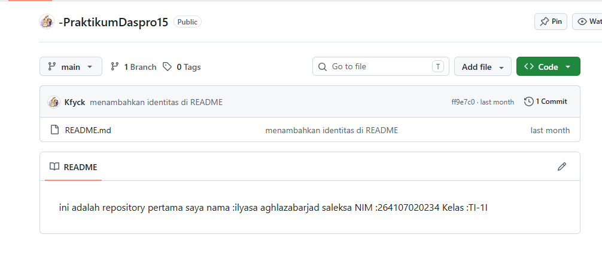
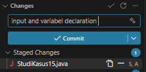
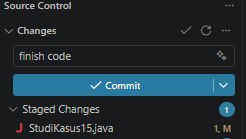
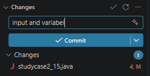
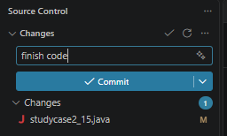

ini adalah repository pertama saya
nama    :ilyasa aghlazabarjad saleksa
NIM     :264107020234
Kelas   :TI-1I 
# Jobsheet 6 — Basic and Nested Selection Structures

## Objectives

1. Students are able to solve case studies using basic and nested selection structures.
2. Students are able to save and submit their work using Git and GitHub through Visual Studio Code.
3. Students are able to collaborate with classmates using GitHub.

## Experiment 2


## Experiment 3 — Cup Purchase and Discount
```java
import java.util.Scanner;

public class StudiKasus15 {
    public static void main(String[] args) {
        Scanner sc = new Scanner(System.in);
        int hargaPerCup = 18000, jumlahCup, uangBayar;
        int totalHarga, diskon = 0, totalBayar;
        int kembalian, kurang;

        System.out.print("Masukkan jumlah cup: ");
        jumlahCup = sc.nextInt();
        System.out.print("Uang yang dibayar: ");
        uangBayar = sc.nextInt();

        totalHarga = jumlahCup * hargaPerCup;
        if (totalHarga >= 100000) {
            diskon = totalHarga * 10 / 100;
        } else {
            diskon = 0;
        }
        totalBayar = totalHarga - diskon;
        System.out.println("Discount: " + diskon);
        System.out.println("Total price: " + totalHarga);
        System.out.println("Total to pay: " + totalBayar);

        if (totalHarga >= totalBayar) {
            kembalian = totalHarga - totalBayar;
            System.out.println("Here's your change, boss: " + kembalian);
        } else {
            kurang = totalBayar - totalHarga;
            System.out.println("Your money isn't enough, mate: " + kurang);
        }
        sc.close();
    }
}
```

## Experiment 4 — Student Activity Funding
```java
import java.util.Scanner;

public class studycase2_15 {
    public static void main(String[] args) {
        Scanner sc = new Scanner(System.in);
        String studentName, activityType;
        System.out.print("Student name: ");
        studentName = sc.nextLine();

        System.out.print("Activity type (BELMAWA, BAKORMA, Mandiri, PKM, or Others): ");
        activityType = sc.nextLine();

        if (activityType.equalsIgnoreCase("BELMAWA")
                || activityType.equalsIgnoreCase("BAKORMA")
                || activityType.equalsIgnoreCase("Mandiri")) {

            System.out.print("Competition rank (1/2/3, enter 0 if not ranked): ");
            int competitionRank = sc.nextInt();

            System.out.print("Number of uploaded documents (0-4): ");
            int documentCount = sc.nextInt();

            if (competitionRank >= 1 && competitionRank <= 3
                    && documentCount == 4) {
                System.out.println("Name: " + studentName);
                System.out.println("Funding status: Award granted");
                System.out.println("Competition rank: " + competitionRank);
                System.out.println("Activity type: " + activityType);
                System.out.println("All documents are complete.");
            } else {
                System.out.println("Name: " + studentName);
                System.out.println("Funding status: Not granted");

                if (competitionRank < 1 || competitionRank > 3) {
                    System.out.println("Must achieve 1st, 2nd, or 3rd place.");
                }

                if (documentCount < 4) {
                    System.out.println("Missing documents: "
                            + (4 - documentCount));
                }
            }

        } else if (activityType.equalsIgnoreCase("PKM")) {
            System.out.print("Funding approval (1=Approved, 0=Not approved): ");
            int fundingStatus = sc.nextInt();

            System.out.print("Number of uploaded documents (0-4): ");
            int documentCount = sc.nextInt();

            if (fundingStatus == 1 && documentCount == 4) {
                System.out.println("Name: " + studentName);
                System.out.println("Funding status: Granted");
            } else {
                System.out.println("Name: " + studentName);
                System.out.println("Funding status: Not granted");

                if (fundingStatus == 0) {
                    System.out.println("PKM funding was not approved.");
                }

                if (documentCount < 4) {
                    System.out.println("Missing documents: "
                            + (4 - documentCount));
                }
            }

        } else if (activityType.equalsIgnoreCase("Others")) {
            System.out.print("Number of uploaded documents (0-4): ");
            int documentCount = sc.nextInt();

            System.out.println("Name: " + studentName);
            System.out.println("Funding status: Not granted");

            if (documentCount < 4) {
                System.out.println("Missing documents: "
                        + (4 - documentCount));
            }

        } else {
            System.out.println("Invalid activity type.");
        }
        sc.close();
    }
}
```

## Experiment 5
## Study Case 2 Testing Results by Putra

Testing was conducted using three student records with different activity types and document submission counts.

| No. | Student Name | Activity Type | Competition Rank / Funding Approval | Uploaded Documents | Program Output | Description |
|:---:|:---|:---:|:---|:---:|:---|:---|
| 1 | Putra | PKM | Approved (1) | 3 | Funding status: Not granted; Missing documents: 1 | Funding was not granted because 1 document was missing. |
| 2 | Ilyas | MANDIRI | Rank 1 | 2 | Funding status: Not granted; Missing documents: 2 | Funding was not granted because 2 documents were missing. |
| 3 | Wisnu | BAKORMA | Rank 2 | 4 | Award granted; Competition rank: 2; Activity type: BAKORMA; All documents are complete. | The student received the award because all requirements were fulfilled. |


### GitHub repository



### Experiment 3 — Git changes





### Experiment 4 — Git changes





---
